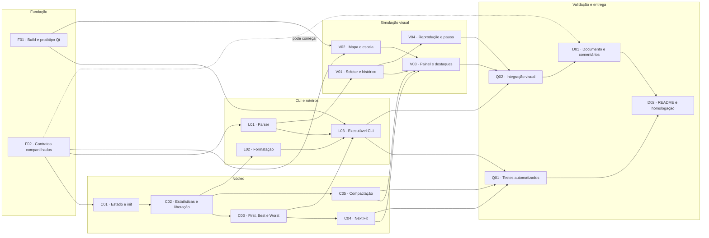

# Plano de implementação do simulador de gerência de memória

## Revisão da especificação e do plano original

A especificação é a referência de aceite. O PDF do backlog propõe C++17, um núcleo compartilhado e três frentes de trabalho. Este plano mantém essa divisão e acrescenta contratos, dependências e casos verificáveis. O repositório parte de um README mínimo e dos dois PDFs. O backlog abaixo registra o andamento das tarefas.

| Fonte | Obrigação | Tarefas |
|---|---|---|
| Especificação, pp. 1–3 | CLI, quatro algoritmos, liberação por ID/endereço, coalescência, mapa e estatísticas | C01–C04, L01–L03, Q01 |
| Especificação, pp. 2–4 | Compactação INIT, END e OPT, ordem preservada e métricas de movimentação | C05, L02, V03, Q01 |
| Especificação, pp. 4–5 | Arquivo escolhido pelo usuário, mapa completo, escala, cores por bloco, mudanças, buraco escolhido, ponteiro, passo, estatísticas e erro | L01, V01–V03, Q02 |
| Especificação, p. 5 | Avançar, Voltar com restauração exata, reprodução com intervalo decimal, Pausar e Reiniciar | V01, V04, Q02 |
| Especificação, pp. 5–6 | Código comentado, documento de implementação e README para executar os dois modos | D01–D02 |

### Ajustes em relação ao backlog original

- **Roteiros.** O parser é compartilhado, mas o filtro de `show` e `stats` pertence à visualização. A CLI aceita os mesmos arquivos e executa essas consultas, inclusive quando recebe o roteiro pelo stdin.
- **Next Fit.** O cenário de divergência do backlog começa com seis alocações First Fit e espera o ponteiro em 48. O contrato deve explicitar a atualização após todo `alloc` bem-sucedido, qualquer que seja o algoritmo. Na tela, o ponteiro usado para a busca e o ponteiro resultante são dados distintos. No passo 6 do exemplo, a busca parte de 24 e termina com o ponteiro em 28.
- **Voltar.** A cópia inclui o estado anterior à inicialização, os blocos, o próximo ID e o ponteiro. A navegação também recupera o resultado do passo anterior, para restaurar mensagem, destaque e número do passo.
- **OPT.** O critério é a soma dos tamanhos dos blocos cujo endereço mudou. O backlog já prevê desempate pelo maior `k`. Acrescentar um teste cujo mínimo está no interior e é menor que o custo de INIT e END.
- **Mapa.** O exemplo da CLI tem um caractere por byte. Amostrar memórias grandes pelo primeiro byte de cada célula pode esconder blocos. A visualização terá acesso a todos os intervalos, inclusive aos estreitos. A CLI mantém um caractere por byte e escreve em fluxo. Para IDs com mais de um dígito, usar o último dígito no mapa e o ID inteiro na lista de blocos ativos.
- **Prioridade.** Exibir o buraco escolhido é obrigatório. Mostrar a sequência de buracos examinados é desejável pela especificação. O núcleo registra a sequência para testes e permite acrescentar essa exibição depois que a navegação e os destaques obrigatórios estiverem prontos.

### Decisões propostas para começar

- **Build.** C++17 e CMake/CTest, com verificação inicial em Linux. A equipe confirma as demais plataformas em F01. A CLI e os testes do núcleo devem compilar independentemente da tecnologia visual.
- **Visual.** Adotar Qt 6 Widgets para a aplicação desktop. O protótipo de F01 valida a instalação e a integração com CMake nas máquinas da equipe. Usar um executável separado, `memsim-visual`, com a mesma biblioteca C++ da CLI.
- **Erros e sintaxe.** Aceitar comandos e opções sem distinção entre maiúsculas e minúsculas, espaços externos, linhas vazias, comentários de linha inteira e arquivos CRLF. Na visualização, recusar erros de sintaxe com número da linha e exigir que o primeiro passo seja um `init` válido. Comandos sintaticamente válidos com erro de execução contam como passos. Na CLI, imprimir o erro e continuar lendo. Antes de `init`, comandos de memória e consultas retornam erro.
- **Saída.** Propor sucesso silencioso para `init`, `alloc` e liberações. `show` inclui mapa, blocos ativos e estatísticas. `stats` imprime apenas as estatísticas. `defrag` imprime contagem e bytes deslocados. Usar ponto e duas casas no percentual da CLI. Formato de `defrag`, IDs longos e eventuais exigências de correção automática ficam registrados para confirmação com o professor. A implementação pode avançar com esses padrões isolados no formatador.
- **Escopo inicial.** Recursos extras do backlog, como `--verbose`, comandos de ajuda e empacotamento multiplataforma, ficam para depois do aceite funcional.

## Contrato entre módulos

- **Núcleo (`core/`).** `MemoryManager` copiável por valor, com estado inicial vazio. Cada `Block` tem início, tamanho e identificador, com ID 0 reservado a buracos. Usar intervalos semiabertos `[início, fim)`. O vetor ordenado cobre toda a memória com tamanhos positivos e sem buracos adjacentes. IDs ativos são únicos. O ponteiro fica entre zero e a capacidade, inclusive. Manter `init`, `alloc`, `freeId`, `freeAddr`, `getStats` e `defrag` como operações do núcleo. Implementar `show` na CLI a partir da consulta dos blocos e de `getStats`.
- **Resultado da operação.** Retornar sucesso ou erro com seus parâmetros, ponteiro antes/depois e os dados pertinentes à operação. Em `alloc`, registrar buracos examinados e escolhido **antes** da divisão, mais o bloco alocado. Em `free`, guardar o bloco liberado, os buracos vizinhos unidos e o intervalo resultante. Em `defrag`, guardar ID, origem, destino e tamanho dos blocos movidos, mais contagem e total de bytes. Guardar os dados por valor para que continuem válidos após mutações.
- **Comandos (`script/`).** Converter texto em comando tipado com linha original e número de linha. Separar análise sintática, execução e formatação. O executor despacha operações ao mesmo núcleo para ambos os modos. Consumir todos os argumentos, validar faixa numérica e rejeitar valores fora do domínio, com zero permitido como endereço.
- **Interface Qt (`visual/qt/`).** Usar `QMainWindow` para os controles e o painel do passo, `QFileDialog` para selecionar o roteiro, um `QWidget` com `QPainter` para a escala e o mapa, e `QTimer` para a reprodução. A janela encaminha ações ao controlador e atualiza a tela com o estado resultante.
- **Histórico (`visual/`).** O controlador usa C++ padrão e pode ser testado via CTest sem Qt ou janela. Manter uma entrada inicial mais uma entrada por passo executado, com cópia da memória e resultado do comando. `Voltar` restaura a entrada anterior e descarta o passo desfeito. `Avançar` a partir daí executa novamente o comando correspondente. `Reiniciar` restaura a entrada inicial do arquivo atual. Arquivo novo válido troca o roteiro e limpa o histórico. Arquivo inválido preserva a sessão carregada.

### Assinaturas e regras de fronteira

- [`core/memory_manager.hpp`](../core/memory_manager.hpp) declara o estado do núcleo. Capacidade zero, vetor vazio e ponteiro zero representam o estado anterior ao primeiro `init`. Um `init` válido reinicia a sequência de IDs e o ponteiro. Antes de inicializar, operações e consultas retornam `NotInitialized`.
- Endereços e tamanhos usam `int`. O tipo `Block` fica em [`core/block.hpp`](../core/block.hpp). Tamanhos válidos ficam entre 1 e `INT_MAX`. A validação de um intervalo exige início entre zero e a capacidade e tamanho positivo de até `capacidade - início`. `Block::getEnd()` devolve o limite exclusivo com soma em `int64_t`. O endereço inicial de um bloco ativo é sempre menor que a capacidade; o ponteiro Next Fit pode chegar à capacidade.
- IDs de blocos usam `std::uint64_t`. O contador guarda o último ID emitido, começa em zero e só é incrementado após alocação bem-sucedida. Ao chegar a `UINT64_MAX`, a próxima alocação que precisaria de um ID retorna `IdExhausted` antes da soma, preservando o estado. A cópia de `MemoryManager` preserva a sequência de IDs.
- [`core/operation_result.hpp`](../core/operation_result.hpp) agrupa os tipos de retorno e de erro. `init`, `alloc`, `freeId`, `freeAddr` e `defrag` retornam `StepResult`. Em falhas, o ponteiro anterior e o posterior são iguais e o estado permanece intacto. A falta de espaço informa pedido, livre total e maior buraco para formatação na interface. `getStats()` retorna `Stats` ou `OperationError`; uma memória cheia tem zero buracos e maior buraco zero.
- [`script/command.hpp`](../script/command.hpp) declara argumentos tipados e a linha original, numerada a partir de 1. O parser deve rejeitar números fora da faixa do campo de destino antes de criar o comando. `parseLine` distingue comando, linha ignorada e erro de sintaxe. `execute` retorna `StepResult` para mutações, `MemoryView` para `show` e `Stats` para `stats`. Consultas malsucedidas retornam `OperationError`.

## Backlog detalhado

A cuida do núcleo, B da CLI e do build, C da visualização, seguindo os papéis do plano original. As dependências indicam o que precisa estar disponível para fechar cada tarefa. A interface de F02 permite trabalho inicial com dados de exemplo enquanto o núcleo é implementado.

### Fundação

- [ ] **F01 · Build e prova da interface visual** · B e C · sem dependências. B cria `CMakeLists.txt` com biblioteca do núcleo, CLI e CTest. Adicionar a opção `MEMSIM_BUILD_VISUAL` (padrão `OFF`). Quando ligada, localizar `Qt6` com o componente `Widgets` e vincular `Qt6::Widgets` ao executável `memsim-visual`. C monta um protótipo que abre um `.cmd`, desenha três blocos e alterna estados de exemplo a cada 500 ms. **Aceite:** CLI e testes compilam com a opção desligada, inclusive em ambiente sem Qt. Com a opção ligada, o protótipo compila e roda nas máquinas disponíveis da equipe. Registrar os pré-requisitos e comandos validados.
  - Aceite local em Linux com GCC 11 e CMake 3.22. Build limpo com a interface desabilitada por padrão, CLI sem vínculo com Qt e CTest com 1/1 teste aprovado. Build limpo com Qt 6.2.4 e `MEMSIM_BUILD_VISUAL=ON` com 2/2 testes aprovados.
  - Verificação da interface via plugin `offscreen`: abertura de um `.cmd` pelo seletor, prévia fiel ao arquivo, três regiões distintas no mapa, transições de aproximadamente 500 ms, pausa e parada ao final. Pré-requisitos e comandos estão no [README](../README.md). Resta confirmar a execução nas demais máquinas da equipe.
- [ ] **F02 · Definir tipos e interfaces compartilhados** · A, com revisão de B e C · sem dependências. Registrar assinaturas, tipos de dados e retorno por operação, incluindo estado pré-init e erros. Definir cálculo de endereços dentro da capacidade e contador de IDs com faixa segura, evitando overflow ou reciclagem. **Aceite:** declarações compilam e cada frente consegue construir um comando e ler um resultado de exemplo sem depender dos detalhes internos.
  - Aceite técnico local aprovado. Cada cabeçalho compilou isoladamente em C++17. Um programa de verificação usou somente os tipos públicos para construir os sete comandos, ler resultados de exemplo e conferir o estado pré-`init`, a cópia do estado e os limites dos endereços e IDs. Builds limpos com CTest aprovado sem Qt (1/1) e com Qt (2/2). Resta a revisão de B e C.

### Núcleo

- [x] **C01 · Estado e inicialização** · A · F02. Criar o vetor de blocos e rotina de verificação das invariantes. Validar tamanho positivo antes de alterar o estado. Reinicializar toda a memória, próximo ID e ponteiro em `init` válido. **Aceite:** `init 64` gera um buraco `@0 +64`, próximo ID 1 e ponteiro 0, inclusive após uma sessão com alocações.
- [ ] **C02 · Estatísticas e liberação** · A · C01. Calcular ocupado, livre, quantidade de buracos, maior buraco e uso percentual. Encontrar somente blocos ativos por ID ou endereço inicial. Liberar e unir vizinhos livres à esquerda, à direita ou dos dois lados. **Aceite:** liberar o bloco entre dois buracos produz um único intervalo livre, registra a coalescência e preserva o ponteiro. Endereço interior e ID inexistente preservam todo o estado.
- [ ] **C03 · Seleção e alocação First, Best e Worst** · A · C01, C02. Percorrer buracos por endereço, aplicar a regra de escolha, guardar a busca, dividir o buraco quando houver sobra e atribuir ID somente ao confirmar a alocação. Atualizar o ponteiro para o fim do bloco. **Aceite:** endereços 0, 38 e 14 no vetor de divergência de Q01. Empates usam o menor endereço. Encaixe exato elimina o buraco. Falha mantém o estado e fornece total livre e maior buraco.
- [ ] **C04 · Seleção Next Fit** · A · C03. Encontrar o primeiro buraco com fim estritamente maior que o ponteiro e percorrer a lista circular uma vez. Examinar inteiro o buraco que contém o ponteiro e alocar em seu início. Começar pelo primeiro buraco se a posição inicial cair após todos os buracos. **Aceite:** exemplo do enunciado com retorno para 0, cenário com ponteiro igual à capacidade e cenário com ponteiro dentro de buraco após liberação. O cenário misto de Q01 escolhe 48.
- [ ] **C05 · Compactação INIT, END e OPT** · A · C01, C02. Gerar endereços compactados no início e no fim para cada bloco em ordem original. Calcular custos cumulativos de prefixos no início e sufixos no fim para avaliar cada corte `k` em tempo linear. Escolher o menor custo e, em empate, o maior `k`. Aplicar o layout preservando IDs e ordem, emitir movimentos e zerar o ponteiro em todos os modos. **Aceite:** casos de compactação de Q01, memória cheia e memória vazia. Com espaço livre há exatamente um buraco após a operação.

### CLI e roteiros

- [ ] **L01 · Parser e leitura compartilhados** · B · F02. Cobrir todos os comandos obrigatórios. Validar quantidade de argumentos, algoritmo, modo de compactação e faixa numérica. Preservar linha de origem e distinguir conteúdo ignorável de erro. Implementar a preparação visual do roteiro ignorando `show` e `stats` após a validação sintática. **Aceite:** roteiro oficial gera sete passos visuais. Comentários, CRLF, opção inválida, argumentos extras e número fora da faixa têm testes. Erro de sintaxe de arquivo informa a linha.
- [ ] **L02 · Formatação das operações e consultas** · B · F02, C02. Implementar `show` com as duas linhas do mapa e lista de blocos, e reutilizar o formatador de `stats`. Formatar o resultado da compactação a partir do contrato F02, usando dados de teste até C05 estar disponível. Formatar a mensagem obrigatória `Erro: sem espaço contíguo para <N> bytes (livre total: X, maior buraco: Y)`. **Aceite:** fixture da sessão oficial com dois mapas de 64 posições, IDs inteiros na lista, valores 16/48/1/48 e percentual `25.00%`.
- [ ] **L03 · Executável interativo e por stdin** · B · F01, L01, L02, C03. Executar linha por linha por meio do despachante comum, emitir prompt somente em terminal e encerrar em EOF. Documentar o redirecionamento de arquivo. **Aceite:** sessão interativa e execução por stdin produzem o mesmo estado e as mesmas consultas. Arquivo redirecionado roda sem prompt. Erro seguido de comando válido mantém a execução.

### Simulação visual

- [ ] **V01 · Seletor e controlador de passos** · C · F02, L01. Abrir `.cmd` com `QFileDialog` e validar antes de trocar o roteiro. Cancelar a seleção preserva a sessão. Implementar Avançar, Voltar e Reiniciar como operações testáveis sem tela. Mostrar os limites de início e fim e tratar arquivo vazio. **Aceite:** avançar, voltar e avançar de novo após erro e após um segundo `init` reproduz os mesmos IDs, ponteiros, mensagens e passos.
- [ ] **V02 · Mapa completo e escala** · C · F01, F02. Desenhar os intervalos em um `QWidget` com `QPainter`, convertendo endereços em coordenadas proporcionais à largura disponível e marcando os extremos, cores estáveis por ID e buracos visualmente distintos. Exibir ID, endereço e tamanho em uma lista junto ao mapa para manter todos os blocos consultáveis, inclusive quando forem estreitos. **Aceite:** mapa cobre `0..capacidade` em memórias de 8 e 4096 bytes. Um bloco de 1 byte permanece consultável e um ID mantém sua cor após compactação.
- [ ] **V03 · Painel e mudanças por operação** · C · C04, C05, V01, V02. Mostrar comando, passo atual de total, estatísticas e mensagem de erro. Destacar bloco alocado/liberado, resultado da coalescência, movimentos com origem/destino e buraco escolhido antes da divisão. Marcar o ponteiro resultante e informar a posição usada na busca Next Fit. **Aceite:** cada tipo de mudança tem uma demonstração visível. No passo 6 do roteiro Next Fit, a busca começa em 24, o buraco escolhido começa em 24 e a marca atual fica em 28. **Desejável:** mostrar ordem dos buracos examinados, inclusive numa falha.
- [ ] **V04 · Reprodução e pausa** · C · V01. Conectar um único `QTimer` ao controlador e disparar um avanço por intervalo. Ler segundos em um `QLineEdit`, aceitar ponto ou vírgula como separador decimal e converter para milissegundos. Rejeitar entrada incompleta, valores que não sejam positivos e finitos e intervalos convertidos fora de 1 a `INT_MAX` ms. Cancelar reprodução ao pausar, avançar/voltar manualmente, reiniciar, trocar de roteiro ou chegar ao fim. **Aceite:** `0,5` e `0.5` são equivalentes, controles interrompem o avanço pendente e cliques repetidos em Reproduzir não criam dois temporizadores.

### Validação e entrega

- [ ] **Q01 · Testes do núcleo, parser e CLI** · A e B · C02–C05, L01–L03. Adicionar cenários reproduzíveis da tabela abaixo ao CTest. Guardar uma expectativa de texto para a sessão oficial e para a mensagem de falta de espaço. **Aceite:** CTest verifica mapas, métricas, endereços, erros sem mutação e ponteiro. Casos de coalescência cobrem esquerda, direita e ambas. **Desejável:** teste aleatório com semente fixa e invariantes após cada comando.
- [ ] **Q02 · Integração visual e roteiros de demonstração** · C, com revisão de A e B · V01–V04, L03. Incluir em `examples/` exemplos de Next Fit, compactação, divergência e falha. Rodar os mesmos arquivos nos dois modos, conferindo estados finais. Testar controles, carga de arquivo inválido, erros durante passos, navegação e destaques. **Aceite:** cada requisito visual da matriz é demonstrado. Avançar até o fim e voltar até o início recupera os estados registrados na ida. Após pausa, esperar mais que um intervalo e verificar que o passo fica estável.
- [ ] **D01 · Documento de implementação e comentários** · A, B e C · F02 para começar, Q02 para fechar. Explicar estrutura de bloco, invariantes, módulos, seleção de buracos, cálculo de OPT, restauração e decisões de interface. Comentar regras de fronteira, como `fim > ponteiro`, e os motivos das escolhas menos óbvias. **Aceite:** documento descreve o código entregue e justifica as decisões propostas efetivamente adotadas.
- [ ] **D02 · README e homologação do pacote** · B, com A e C · Q01, Q02, D01. Documentar a instalação do Qt 6 Widgets nas plataformas verificadas, a configuração com `-DMEMSIM_BUILD_VISUAL=ON`, build, CTest, execução interativa, redirecionamento e carga do roteiro via seletor. Repetir do zero em outra máquina disponível. **Aceite:** outra pessoa executa os dois modos e os testes a partir do README, e cada obrigação da matriz tem evidência de verificação.

## Vetores de teste prioritários

| Caso | Preparação e ação | Resultado |
|---|---|---|
| Sessão oficial | `init 64`, `alloc 10 first`, `alloc 8 first`, `freeid 2`, `alloc 6 best`, `show` | IDs 1 @0 +10 e 3 @10 +6. Ocupado 16, livre 48, 1 buraco, maior 48, 25.00%. |
| Next Fit oficial | `init 32`, três `alloc 8 next`, `freeid 1`, `alloc 4 next`, `alloc 6 next` | Ponteiros 0, 8, 16, 24, 24, 28, 6. IDs 4 @24 e 5 @0. Ocupado 26, livre 6, 2 buracos, maior 4, 81.25%. Na variante First Fit, IDs 4 @0 e 5 @24. |
| Divergência | Em 64 bytes, alocar 10, 4, 20, 4, 6 e 4 com First. Liberar IDs 1, 3 e 5. A partir de cópias desse estado, pedir 5 bytes com cada algoritmo | First @0, Best @38, Worst @14, Next @48. |
| Empate Best/Worst | Em 20 bytes, alocar 5, 5, 5 e 5. Liberar IDs 1 e 3. Pedir 4 bytes em cópias do mesmo estado | Best e Worst escolhem @0, com sobra de 1 byte. |
| Next no limite e dentro de buraco | Limite: em 16 bytes, alocar 8 duas vezes, liberar ID 1 e pedir 4 com Next. Interior: em 16 bytes, alocar 8, liberar ID 1 e pedir 12 com Next | Limite: ponteiro 16 antes da busca, nova alocação @0, ponteiro 4. Interior: ponteiro 8 dentro de buraco @0 +16, nova alocação @0, ponteiro 12. |
| Falha por fragmentação | Em 24 bytes, alocar três blocos de 8, liberar IDs 1 e 3 e pedir 9. Depois pedir 8 | Falha com livre total 16 e maior buraco 8. O pedido seguinte recebe ID 4. |
| Defrag oficial | Em 64 bytes, alocar 10, 8, 6, liberar ID 2 e executar cada modo em uma cópia | INIT move 2 blocos e 16 B para @48 e @58. END move ID 3 para @10, 6 B. OPT faz o mesmo com `k=2`, vencendo `k=1` no empate. |
| OPT no interior | Em 24 bytes, alocar 4, 2, 4, 2, 12 e liberar IDs 2 e 4 | OPT escolhe `k=2`, move ID 3 de @6 para @4 e mantém IDs 1 e 5 em @0 e @12. Buraco @8 +4. Custos INIT 8 B, END 16 B, OPT 4 B. |
| Estado visual | Em roteiro, `init 16`, `alloc 8 first`, `alloc 12 next` (erro), `init 10`, `alloc 2 next`. Inserir `show` e `stats` após o erro | Cinco passos visuais. Ao voltar do segundo `init`, reaparecem erro, ID 1 @0 +8 e ponteiro 8. A CLI executa as consultas. Reiniciar volta ao estado anterior ao primeiro comando. |

## Grafo de dependências

Uma seta contínua vai do pré-requisito à tarefa que depende dele para concluir. Para facilitar a leitura, o grafo omite dependências já cobertas por um caminho de setas. A seta pontilhada indica quando D01 pode começar. Sua conclusão depende de Q02.



### Versão em texto

Em cada linha, leia `tarefa <- pré-requisitos`. O sinal `+` indica que todos os pré-requisitos listados precisam estar concluídos. Dependências indiretas aparecem ao seguir os IDs nas demais linhas.

```text
Fundação
  F01 · Build e protótipo Qt  <-  sem pré-requisitos
  F02 · Contratos compartilhados  <-  sem pré-requisitos

Núcleo
  C01 · Estado e init  <-  F02
  C02 · Estatísticas e liberação  <-  C01
  C03 · First, Best e Worst  <-  C02
  C04 · Next Fit  <-  C03
  C05 · Compactação  <-  C02

CLI e roteiros
  L01 · Parser  <-  F02
  L02 · Formatação  <-  C02
  L03 · Executável CLI  <-  C03 + F01 + L01 + L02

Simulação visual
  V01 · Seletor e histórico  <-  L01
  V02 · Mapa e escala  <-  F01 + F02
  V03 · Painel e destaques  <-  C04 + C05 + V01 + V02
  V04 · Reprodução e pausa  <-  V01

Validação e entrega
  Q01 · Testes automatizados  <-  C04 + C05 + L03
  Q02 · Integração visual  <-  L03 + V03 + V04
  D01 · Documento e comentários  <-  Q02
  D02 · README e homologação  <-  D01 + Q01
```

D01 pode começar após F02 e ser concluída após Q02.

## Ordem de execução

1. **Começar por F01 e F02.** B inicia o build, A especifica os tipos e C faz o protótipo visual. Assim que F02 estiver disponível, B inicia L01 e C prepara o mapa com dados de exemplo.
2. **Fechar uma fatia funcional.** C01 → C02 → C03 → L02/L03, usando a sessão oficial como demonstração. V01 pode avançar em paralelo com L01.
3. **Completar algoritmos e navegação.** Fechar C04 e C05, ligar o controlador ao núcleo real e fechar V03/V04. Q01 acompanha as operações conforme ficam prontas.
4. **Homologar a entrega.** Rodar Q02, fechar D01/D02 e verificar a matriz de requisitos. Estimar datas depois da validação do protótipo Qt, com a disponibilidade real da equipe.
